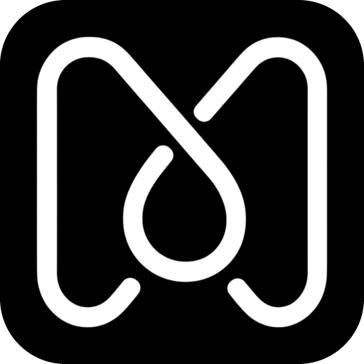

  

<h1 align="center">Misty</h1>

<strong>Build together with AI.</strong>

Misty is a collaborative workspace for building with agents. Pick an engine and build on your
own, or invite others to build with you in a space you all share. It's open source and runs on
macOS and Windows.

[Website](https://mistysys.com) · [Discord](https://discord.gg/B5WgSw6uX) · [Roadmap](https://github.com/orgs/misty-org/projects/1) · [Contributing](CONTRIBUTING.md)

## Goals

- **Anyone can use AI.** Misty takes care of the technical parts for you: installing an
  engine and signing in to it, with no terminal to type into.
- **Any engine you like.** Claude Code, Codex, Antigravity, OpenCode and more in one place, with
  nothing tying you to one of them.
- **Build alone or together.** Your notes, drawings, documents and code live in one space, and
  anyone you invite can build in it with you.

## Features

- **Any engine, one place:** chat with Claude Code, Codex, Antigravity, OpenCode and more, and pick
  up your past chats with them
- **Spaces:** shared places with a group chat, docs and drawings you edit together, tasks and
  files
- **Lab:** notebooks made from your sources, with summaries, mind maps, flashcards, quizzes
  and audio overviews
- **Studio:** a 3D room where you see your agents, and your teammates', at work
- **A browser for agents:** agents work on web pages, and you can watch or take over
- **Apps and plugins:** let your agents use the apps you sign in to and learn new skills

## License

[AGPL-3.0-or-later](LICENSE)
